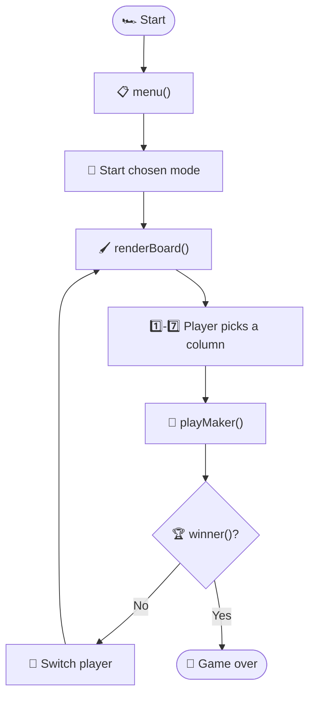

<div align="center">

# 🔴 Connect 4 🟡

### A terminal game built in modern C++20, tuned for speed


</div>

---

## 🎯 About the Project

I am working on a **private project** to learn C++ beyond basic applications. My goal is to gain a deeper understanding of how to implement **modern C++ practices** and achieve **optimal time complexity** in real-world projects, moving beyond competitive programming.

In this project I improved time complexity as much as I could with my current knowledge and the time I given.

Let's now go throght the code to undersatnd what it is and how i improved certain points to improve performence. I will explain this code in four parts.

---

## 🧩 4 Parts That Power the Code

| # | Part | What it is |
|:-:|------|------------|
| 1️⃣ | [🎨 Colors and GUI](#-colors-and-gui) | The aesthetic part when the code is running |
| 2️⃣ | [🗄️ Data Structures and Constants](#️-data-structures-and-constants) | What gives the code performance and a safety net |
| 3️⃣ | [⚙️ Functions](#️-functions) | The magic that powers the code |
| 4️⃣ | [🚀 `int main()`](#-int-main) | Where everything works as one unit |


---

## 🎨 Colors and GUI

### ANSI escape codes

To change text color in a terminal window I used **ANSI escape codes** with bold colors:

```cpp
const string RED = "\033[1;31m";
```

Here is what each piece of that string does:

| Piece | Name | What it does |
|:-----:|------|--------------|
| `\033` | Escape character | Signals the terminal that a command follows |
| `[` | Control Sequence Introducer (CSI) | Marks the start of the command |
| `1` | Bold | Makes the text bold |
| `;` | Separator | Chains multiple formats together |
| `31` | Color code | Selects **red** |
| `m` | Terminator | Signals that the command is over |

> [!IMPORTANT]
> After using a color code we must remove the active color, otherwise **everything after it** that prints have this color which we do not need to happen. That is why I added a `RESET` ANSI code that switch back to the default color of the terminal.


### Game pieces

For user friendly visuals I used these variables, combined with colors:

```cpp
constexpr char EMPTY_GUI = '.', P1_GUI = 'X', P2_GUI = 'O';
```

This helps players to identify pieces quickly and makes the game more pleasing to look at and reduce eye strain (less eye tiredness).

| Symbol | Meaning |
|:------:|---------|
| `.` | ⚪ Empty slot |
| `X` | 🔴 Player 1 |
| `O` | 🟡 Player 2 |

```text
  . . . . . . .
  . . . . . . .
  . . . . . . .
  . . . X . . .
  . . O O X . .
  . X O X O . .
  1 2 3 4 5 6 7
```

This how colored pieces work togher in [`renderBoard`](#-renderboard) to make game more prettier to look at.
<div align="center">

&nbsp;&nbsp;&nbsp;

</div>
---

## 🗄️ Data Structures and Constants

### Custom data structures

For data I that i am going to use over and over, I made custom data structures. Calling one data type once is easier than passing 3 separate values into every mode, and it **reduces human errors**.

**`gamestatus`** holds three different pieces of data:

- 🧱 an **array** for the board
- ⬇️ a **gravity array** that saves each column's lowest point available, so computer does not need to search for it on every move player makes(this cuts time complexity O(n) to O(1) in evertime.)
- 👤 the current player to as a place holder that player 1 always start first in evety new game.

**`direction`** is used instead of `pair` for readability,type safety and easier for the future updates. This data structure used in `winner` function to detemine whether the move is winner move or not. This stores coordinates of the directions that search need to go. See [`winner`](#-winner) for the details.

```cpp
struct gamestatus {
    array<array<int, C>, R> board{};
    array<int, C> gravity{5, 5, 5, 5, 5, 5, 5};
    int cur_p = P1;
};

struct direction {
    int row;
    int col;
};
```

### Constants

I used `constexpr` (C++20) instead of `const` in order to avoid accidentally changing the board size or player values, which is the more modern choice to use constant value that save on compile time.

```cpp
constexpr int R = 6, C = 7;
constexpr int P1 = 1, P2 = 2;
```

---

## ⚙️ Functions

| Function | Job |
|----------|-----|
| [`renderBoard`](#-renderboard) | 🖼️ Draws the board after each move |
| [`menu`](#-menu) | 📋 Chooses the mode to play |
| [`twoplayer`](#-twoplayer) | 👥 Runs the two player mode and handles bad input |
| [`playMaker`](#-playmaker) | 🎯 Decides where each piece lands |
| [`winner`](#-winner) | 🏆 Checks if the last move won the game |


### 🖌 renderBoard

```cpp
void renderBoard(const gamestatus &game);
```

Renders the board after each move and start of the game.

### 📋 menu

```cpp
string menu();
```

Help player to Choose the mode that he diser to play between the available modes.

### 👥 twoplayer

```cpp
void twoplayer();
```

If player chose two plater mode this function runs to start the game between two player switches chances and playing moves using the same key board. It also handles the error cases that a player might cause. few shown below:

- ❌ entering a column that does not exist
- ❌ entering a column that is already full
- ❌ choosing a wrong mode in the menu

### 🎮 playMaker

```cpp
int playMaker(const gamestatus &game, int move, int &headRow);
```

Holds the instructions for what happens after each move is played (**where to put the piece** in the board in the current instance). The [`gravity`](#custom-data-structures) array comes in handy here to reduce time complexity .

### 🏆 winner

```cpp
bool winner(const array<array<int, C>, R> &board, int prev_row, int prev_col, int player);
```

Rather than searching the whole board to see if a winning move exists, this function checks whether **the last move** is a winner move or not using the `direction` data type (that hold cordinates of the searching directions).

> [!NOTE]
> A visual explanation is shown below.

<div align="center">

</div>

---

## 🚀 `int main()`

This is where the magic happens. All the functions work together to make the game work, from the beginning of the game to the end:



---

<div align="center">

# 🪔Share Your Light

### *“Thousands of candles can be lit from a single candle, and the life of the candle will not be shortened. Happiness never decreases by being shared.”*
— **Sutta Nipata**🪷

---

### **Share your knowledge** 

✨ *When you teach others, your own light shines even brighter.* ✨

</div>
